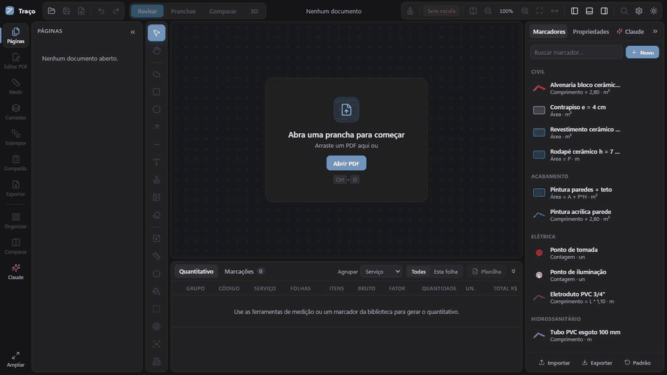

# Traço

**Marque, revise e quantifique pranchas em PDF.** Gratuito e de código aberto, feito por engenheiro, para engenheiros.

🇬🇧 [Read in English](README.en.md) · O app fala **português, inglês, espanhol, francês, alemão, italiano e chinês (simplificado)**.

O Traço abre a prancha em PDF e deixa você medir em cima dela: comprimento, área e contagem, com escala por folha ou por região. O quantitativo se monta sozinho, com fórmulas, ambientes e pavimentos, e sai em Excel. Um modo 3D, ao estilo SketchUp, mostra em volume o que foi medido.

## O que ele faz

- **Medir em cima da planta:** comprimento, área, contagem e vazios (fosso, shaft, pilar). Clique dentro do ambiente e o contorno sai das linhas do PDF.
- **Contagem automática:** envolva um símbolo e o Traço acha os iguais, inclusive girados, nesta folha ou em todas.
- **Quantitativo na hora:** marcadores com fórmulas (`A + P*H`, `L * 1,10`, `ceil(N/10)`…), agrupamento por serviço, ambiente, pavimento, folha ou status, base de preços SINAPI com BDI e exportação para Excel.
- **3D:** desenhe a base de um sólido na planta e puxe a altura com o mouse. Paredes, ambientes e lajes medidos aparecem em volume. Tela dividida (planta e 3D ao vivo) e navegação estilo Revit.
- **Revisão e compatibilização:** nuvens, itens numerados com responsável, prioridade e prazo, relatório em PDF e Excel, comparação entre revisões e sobreposição de disciplinas.
- **Gestão de pranchas:** reordenar, girar, duplicar, extrair, dividir, renomear pelo carimbo, carimbos em lote e OCR em português.
- **Tarja definitiva:** o texto e a imagem sob a tarja somem do PDF de verdade, e o desenho vetorial é preservado para as medições (no app de PC e na versão web).
- **Claude (opcional):** painel com a sua chave da API e servidor MCP para usar com o Claude Desktop.

## Instalar

1. Baixe o instalador `Traco-Setup-…exe` na página de [**Releases**](https://github.com/joseroverato/traco/releases/latest).
2. Execute. No Windows pode aparecer a tela azul do **SmartScreen** ("O Windows protegeu o computador"), porque o app ainda não tem assinatura digital e é novo para o Windows. Clique em *Mais informações* e depois em *Executar assim mesmo*. Para conferir que o arquivo é o original, compare o hash com o do arquivo `SHA256SUMS.txt` da mesma release (`certutil -hashfile Traco-Setup-….exe SHA256` no Prompt de Comando).
3. Abra um PDF ou um projeto `.traco`.

Também há uma **versão web** (`Traco-Web-…zip`, com Docker) para rodar num servidor. As atualizações do app de PC são verificadas ao abrir (Configurações › Sobre).

## Idiomas

O Traço abre no idioma do sistema (ou em inglês, se não for um dos sete) e a troca fica em **Configurações › Sobre › Idioma · Language**. A tradução é de sentido, não literal: os nomes das ferramentas e os termos de obra seguem o uso de cada língua ("quantitativo" vira *takeoff*, *mediciones*, *métré*, *Mengenermittlung*, *computo metrico*, 工程量…). Veja [docs/IDIOMAS.md](docs/IDIOMAS.md) para o glossário e para corrigir ou acrescentar um idioma.

## Privacidade

Tudo roda no seu computador: os PDFs não são enviados a lugar nenhum. As únicas conexões são a verificação de atualização (consulta as releases no GitHub) e, **só se você usar o painel do Claude**, o envio das folhas que você pedir à API da Anthropic, com a sua chave (guardada criptografada no PC).

## Feito com IA

O Traço foi construído com ajuda de inteligência artificial (Claude). A visão do que um engenheiro precisa, os testes em planta real e as decisões são humanos; a IA ajudou a escrever, testar e corrigir o código. Os testes automatizados cobrem os cálculos (medições, fórmulas, quantitativo, formato do projeto e regras do 3D).

## Política de assinatura de código

O instalador do Windows ainda **não é assinado**. A assinatura gratuita para projetos de código aberto está sendo solicitada ao [SignPath Foundation](https://signpath.org); enquanto a resposta não vem, valem o aviso e a conferência de hash descritos em *Instalar*. Quando for aprovada, só serão assinados instaladores gerados pelo fluxo automático deste repositório (GitHub Actions), a partir do código público, e cada versão exigirá aprovação manual.

- **Autor, revisor e aprovador:** José Roverato ([@joseroverato](https://github.com/joseroverato)), com autenticação em dois fatores no GitHub.
- **Privacidade:** o programa não coleta nem envia dados. As únicas conexões são a consulta de atualização às releases do GitHub e, só se você usar o painel do Claude, o envio das folhas que você pedir à API da Anthropic (veja *Privacidade*).

## Contribuir

Achou um erro, falta uma função ou tem uma ideia? Abra uma [issue](https://github.com/joseroverato/traco/issues). Veja [CONTRIBUTING.md](CONTRIBUTING.md) para rodar o projeto e enviar mudanças.

## Licença

[MIT](LICENSE). As bibliotecas de terceiros e suas licenças estão em [THIRD_PARTY_LICENSES.md](THIRD_PARTY_LICENSES.md).

---

# Para desenvolvedores

## Rodar em desenvolvimento
Requer Node.js 22 ou superior.

    npm install
    npm run dev        # abre em http://localhost:5173

## Gerar builds
    npm run build:web        # dist/ — versão web leve (servidor; ver deploy/ para Docker)
    npm run build:preview    # dist-single/index.html — prévia em arquivo único
    npm run desktop          # roda o app de PC (Electron) em desenvolvimento
    npm run dist:win         # release/ — app de PC para Windows (.zip; no Windows: dist:win-installer gera instalador)

## Arquitetura
- src/ — interface (React + TypeScript), igual para web e PC
- src/commands.ts + src/tools.json — ferramentas do Claude (painel e MCP usam as mesmas)
- src/ai.ts — conversa com a API da Anthropic (tool use, imagens das folhas)
- electron/main.cjs — app de PC: arquivos nativos, chave criptografada, ponte local p/ MCP
- shared/redact-core.mjs — tarja definitiva com PDFium/WASM (preserva o vetor), usada pelo app de PC e pela versão web (src/redactWeb.ts).
- electron/engine.mjs — motor do PC: carrega o PDFium para o código compartilhado + Tesseract (OCR pt). Otimização de tamanho fica em src/pdfexport.ts (pdf-lib), igual na web
- electron/mcp-server.mjs — servidor MCP (stdio) para o Claude Desktop; abre o Traço se estiver fechado
- deploy/ — Dockerfile + nginx + compose da versão web e scripts de instalação do PC

## Modos
- **Revisar**: marcações, medições, carimbos, imagens, viewports, quantitativo
- **Pranchas**: reordenar (arrastar), girar, duplicar, excluir, folha em branco, inserir PDF,
  extrair, dividir (.zip), renomear por padrão ou detectando o número no carimbo
- **Comparar**: sobrepõe duas revisões (vermelho = removido, azul = acrescentado),
  detecta as regiões alteradas e cria nuvens automaticamente na revisão nova
- **3D**: mostra em volume o que foi medido na folha (sólidos, ambientes, paredes, lajes e contagens),
  com resumo em m³ por camada, tooltip ao passar o mouse e seleção. O **sólido** (tecla U) é desenhado
  na planta (base) e a altura é ajustada nas propriedades ou **puxando/empurrando a seta laranja** no 3D
  (Alt = passo de 1 cm). Volume (m³) entra no quantitativo; variáveis de fórmula: `VOL`, `AL` (área lateral
  / da parede) e `ALT`. Código: `src/solids.ts` (puro, testado), `src/scene3d.ts` (three.js) e `src/components/View3D.tsx`.
- **Navegação no 3D (estilo Revit)**: roda = zoom no cursor · botão do meio = mover · Shift + botão do meio = girar.
  **Dividir a tela** (barra superior): planta e 3D lado a lado, ao vivo.
- **Dicas das ferramentas**: texto e animação em `src/toolInfo.ts` (desenho em `components/ToolDemo.tsx`).
  Para usar um vídeo gravado no lugar da animação, coloque `src/assets/tools/<id>.mp4` (ou `.webm`).

## Exportar PDF (Ctrl+E)
Grava marcações/carimbos/imagens no PDF, cria índice de folhas (marcadores), rótulos de página
com o nome da folha, metadados, e pode remover anotações que vieram no original.

## Fórmulas nos marcadores
Variáveis: L comprimento · A área · P perímetro · N contagem · H fator. Ex.: `A + P*H` (pintura de
paredes + teto a partir de uma área), `P` (rodapé), `L * 1,10` (perda de 10%), `ceil(N/10)`.

## Atalhos
V selecionar · H mover vista (ou segurar Espaço / botão do meio) · C nuvem · R retângulo · E elipse
A seta · I linha · T texto · B carimbo · P imagem · L comprimento · K área · N contagem
U sólido 3D · X viewport (escala própria) · S calibrar escala
Roda do mouse = zoom no cursor · 0 folha inteira · W largura · PageUp/PageDown troca de folha
Enter / duplo clique finaliza medição · Backspace desfaz vértice · Shift trava ângulo
Ctrl+Z/Y desfazer/refazer · Ctrl+S salvar projeto (.traco) · Del exclui
Ctrl+1/2/3 ocultam o painel lateral, o quantitativo e o painel da direita

## Estrutura
src/components  Viewer (render + desenho), painéis, barra
src/geometry.ts cálculos (comprimento, área, escala)
src/summary.ts  quantitativo e exportação Excel
src/project.ts  salvar/abrir projeto .traco (PDF + marcações em um arquivo)
src/projectFormat.ts  formato do .traco: v3 = ZIP (project.json + PDFs em binário); abre também o v2 (JSON/base64). Mudou o formato? suba PROJECT_VERSION e escreva a migração em MIGRATIONS

## Testes
    npm test           # Vitest: fórmulas, geometria, quantitativo, histórico, formato do projeto, 3D

## Publicar uma versão nova (atualização automática)

1. Suba o número em `package.json` (ex.: `1.3.1`) e escreva `docs/notas/v1.3.1.md`.
2. `git commit -am "1.3.1" && git push` (na branch `main`).
3. Ao ver o número novo em `package.json`, o GitHub Actions (`.github/workflows/release.yml`) roda tipos, lint e testes, gera `Traco-Setup-1.3.1.exe`, `latest.yml` e `Traco-Web-1.3.1.zip` e cria a Release `v1.3.1`. Se a versão já foi publicada, ele não faz nada.

O app verifica a release mais recente ao abrir e avisa quando houver versão nova (Configurações › Sobre). Para uma cópia **privada** do repositório, cole em Configurações › Atualizações um token *fine-grained* com **Contents: Read-only**; ele fica criptografado no PC.

## Roadmap
- [x] Fase 1: layout, visualizador, marcações, escala, quantitativo, Excel, projeto
- [x] Fase 2: viewports, status personalizáveis, fórmulas, gestão de pranchas, edição/exportação de PDF,
      carimbos em lote, comparação de revisões
- [x] Fase 3: integração com Claude (painel com API + servidor MCP para o Claude Desktop)
- [x] Fase 4: app de PC (Electron, motor completo) e versão web leve com Docker
- [x] Fase 5: modo 3D (sólidos, tela dividida, navegação estilo Revit)
- [x] Fase 6: sete idiomas (pt, en, es, fr, de, it, zh), com tradução de sentido
- [ ] Próximos: assinatura digital do instalador, versão para Linux, pavimentos empilhados no 3D, formas prontas (cilindro, prisma)
